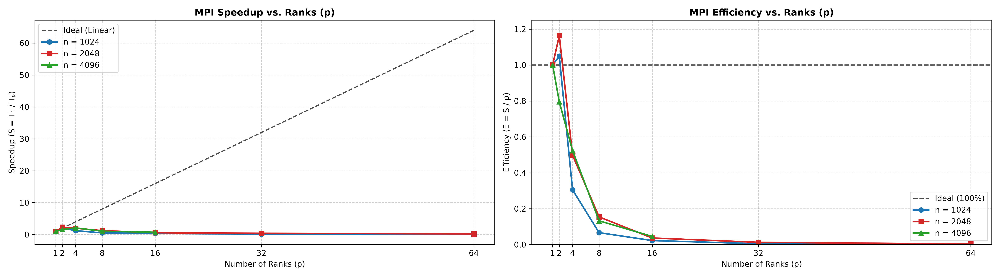
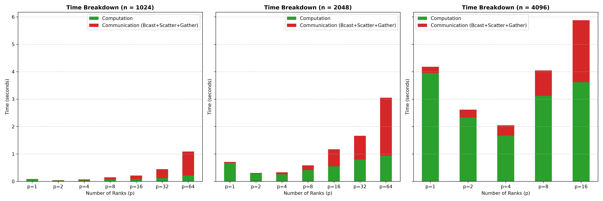

# Docker MPI matrix multiplication

This project benchmarks dense square matrix multiplication using MPI across
two Docker containers. Each MPI rank computes a row block of the output; ranks
exchange matrix data with broadcast, scatter, and gather operations. The
experiment was run on an **Intel Core i5, 10th generation, with 4 CPU cores**.
The exact processor model and clock, memory configuration, rank binding, and
system load were not recorded.

This README uses the artifacts under [`code/`](./code) as the benchmark
source:

- [`mpi_benchmark_results.csv`](./code/mpi_benchmark_results.csv): measured
  times and calculated metrics.
- [`mpi_performance_plots.png`](./code/mpi_performance_plots.png): speedup
  and efficiency plots.
- [`mpi_time_breakdown_plots.png`](./code/mpi_time_breakdown_plots.png):
  compute and communication breakdown.
- [`run_exp.py`](./code/run_exp.py): benchmark launcher.
- [`worker.py`](./code/worker.py): MPI matrix multiplication and timers.
- [`generate_plots.py`](./code/generate_plots.py): plotting script.
- [`hostfile`](./code/hostfile): MPI host addresses and slot counts.
- [`docker-compose.yml`](./docker-compose.yml) and
  [`Dockerfile`](./Dockerfile): container and network configuration.

## Project design

The Compose configuration starts a `master` and a `slave1` container, both
built from the same Dockerfile. Each container mounts the local `code/`
directory at `/home/mpiuser/code` and the SSH configuration directory at
`/ssh`. The entrypoint installs the mounted SSH key files into the `mpiuser`
home directory; Open MPI uses SSH to launch ranks on the other container.

The hostfile assigns two MPI slots to each container, for four configured
slots altogether. Both containers share the same physical host CPU; the
containers do not each have two dedicated cores. Therefore, four ranks use
all four configured slots, while runs with 8 to 64 ranks oversubscribe those
slots and the reported four-core host.

The Compose network is a `macvlan` network attached to the host interface
`eth0`, with static container IP addresses `192.168.10.31` and
`192.168.10.32` on subnet `192.168.10.0/24`. This is environment-specific:
the Docker host must have an `eth0` interface and the subnet and addresses
must be available on the local network. A different host or network may need
different Compose and hostfile settings.

The Dockerfile uses Python 3.12 on Debian Bookworm, installs Open MPI and SSH,
and adds NumPy, mpi4py, pandas, and Matplotlib. BLAS/OpenMP thread variables
are set to one so that each MPI rank does not also start a pool of CPU
threads.

## Matrix multiplication and timing method

The benchmark uses `float64` matrices of dimensions `n × n`, for
`n = 1024`, `2048`, and `4096`. For each repetition:

1. Rank 0 creates matrices `A` and `B`.
2. Every rank receives the full `B` matrix using `MPI_Bcast`.
3. Rows of `A` are distributed with `MPI_Scatter`.
4. Each rank computes `A_local @ B`.
5. The partial output rows are combined on rank 0 with `MPI_Gather`.

The worker verifies the gathered result against a serial matrix multiplication
on the first repetition. Four repetitions are performed for each recorded
configuration. For every repetition, the worker reduces each phase and total
time with `MPI_MAX`; timings therefore reflect the slowest rank. The CSV
reports the median of the four resulting samples.

Metrics in the CSV and tables:

- **Total:** median elapsed time for a complete iteration, in seconds.
- **Compute:** median local matrix-multiplication time, in seconds.
- **Communication:** sum of median broadcast, scatter, and gather times.
- **Speedup:** `S = T₁ / Tₚ`, using the one-rank total time for the same
  matrix size as `T₁`.
- **Efficiency:** `E = S / p`, where `p` is the number of MPI ranks.

The one-rank measurement is the MPI baseline, not a separate non-MPI
implementation. Total timing includes synchronization barriers in addition
to the explicitly timed communication and compute phases. Since the total
and each phase are summarized independently, compute plus communication
does not have to equal the total exactly.

## Results

The intended rank sweep is `p = [1, 2, 4, 8, 16, 32, 64]` for each matrix
size. There are 19 successful configurations in the CSV: the 1024 and 2048
matrices have results at all seven rank counts, while the 4096 matrix has
results only at 1, 2, 4, 8, and 16 ranks. The attempted 4096 runs at 32 and
64 ranks crashed. Those failed attempts have no CSV measurements and are not
included in the result tables; they are failed benchmark runs, not zero-time
measurements. All times below are in seconds; communication,
speedup, and efficiency are calculated as described above.

### Matrix size `n = 1024`

| Ranks (`p`) | Total | Compute | Communication | Speedup | Efficiency |
|---:|---:|---:|---:|---:|---:|
| 1  | 0.0874 | 0.0840 | 0.0037 | 1.000× | 100.00% |
| 2  | 0.0416 | 0.0323 | 0.0097 | 2.099× | 104.93% |
| 4  | 0.0717 | 0.0401 | 0.0307 | 1.219× | 30.48% |
| 8  | 0.1645 | 0.0735 | 0.0737 | 0.531× | 6.64% |
| 16 | 0.2431 | 0.0808 | 0.1315 | 0.359× | 2.25% |
| 32 | 0.5689 | 0.1199 | 0.3243 | 0.154× | 0.48% |
| 64 | 1.4173 | 0.2128 | 0.8757 | 0.062× | 0.10% |

Two ranks are fastest at 0.0416 s, a measured reduction of about 52.3% from
the one-rank runtime. The reported 2.099× speedup and 104.93% efficiency are
superlinear. They are possible in a short, noisy experiment due to variation
in the baseline and system/runtime effects; they should not be interpreted
as a stable result beyond ideal scaling. Adding ranks beyond two increases
the runtime. At eight ranks, communication is already approximately equal
to computation. At 64 ranks, communication is more than four times the
compute time and the run takes about 34 times as long as the two-rank case.

### Matrix size `n = 2048`

| Ranks (`p`) | Total | Compute | Communication | Speedup | Efficiency |
|---:|---:|---:|---:|---:|---:|
| 1  | 0.7122 | 0.6745 | 0.0366 | 1.000× | 100.00% |
| 2  | 0.3062 | 0.2771 | 0.0290 | 2.326× | 116.32% |
| 4  | 0.3573 | 0.2586 | 0.0740 | 1.993× | 49.83% |
| 8  | 0.5776 | 0.4113 | 0.1740 | 1.233× | 15.41% |
| 16 | 1.2138 | 0.5500 | 0.6198 | 0.587× | 3.67% |
| 32 | 1.7639 | 0.7943 | 0.8677 | 0.404× | 1.26% |
| 64 | 3.2759 | 0.9393 | 2.1119 | 0.217× | 0.34% |

Two ranks are fastest at 0.3062 s, about 57.0% less than the one-rank time.
The 116.32% efficiency is again superlinear and should be treated as a
measurement artifact/variation to investigate, rather than as a repeatable
scaling claim. Four ranks are close in total runtime, but do not improve on
two ranks. From 16 ranks upward communication time becomes comparable to or
greater than compute time. At 64 ranks, the total runtime is more than ten
times the two-rank runtime.

### Matrix size `n = 4096`

| Ranks (`p`) | Total | Compute | Communication | Speedup | Efficiency |
|---:|---:|---:|---:|---:|---:|
| 1  | 4.2851 | 3.9515 | 0.2302 | 1.000× | 100.00% |
| 2  | 2.6948 | 2.3266 | 0.2884 | 1.590× | 79.51% |
| 4  | 2.0471 | 1.6736 | 0.3735 | 2.093× | 52.33% |
| 8  | 4.0412 | 3.1202 | 0.9245 | 1.060× | 13.25% |
| 16 | 5.9334 | 3.6182 | 2.2598 | 0.722× | 4.51% |

For the largest matrix, four ranks are fastest at 2.0471 s, about 52.2% less
than the one-rank time. Unlike the two smaller sizes, performance improves
from two to four ranks, indicating that this larger problem can use more of
the four available slots. Eight ranks are only marginally faster than one
rank, and 16 ranks are slower. The attempted 32- and 64-rank runs crashed, so
there is no measured performance result for those configurations.

## Reading the plots



In the speedup panel, the dashed diagonal is ideal linear scaling. The
measured curves peak at two ranks for `n = 1024` and `n = 2048`, and at four
ranks for the successful `n = 4096` runs, then decline. The 4096 series ends
at 16 because its 32- and 64-rank runs crashed. In the efficiency panel, the
dashed line marks 100% efficiency. Efficiency is below that ideal in nearly
all cases;
the two superlinear two-rank values for the smaller matrices are visible
above 100% and warrant repeated measurements.



The green bars show computation and the red stacked segment shows the sum of
broadcast, scatter, and gather times. With more ranks, less computation is
assigned to each rank, but the communication and synchronization costs grow.
The resulting overhead is especially harmful when the rank count exceeds the
four configured slots. The bar sums need not equal total time exactly because
total time includes barriers and the component medians are calculated
separately.

## Results versus the checked-in run script

The plots match the successful measurements in the CSV. Their shared x-axis
includes rank counts present for at least one matrix size: consequently the
`n = 4096` series ends at 16, while the other two series extend to 64. The
missing 4096 points at 32 and 64 reflect the reported crashes, not a decision
to use a different rank sweep for that matrix.

There is a version mismatch between the intended/run configuration and the
checked-in [`run_exp.py`](./code/run_exp.py): the file currently lists
`[1, 2, 4, 8, 16, 32]`, whereas the intended sweep and CSV also include 64
ranks for the two smaller matrices. The CSV is the source for measured
results documented here. To reproduce the full intended sweep, include 64 in
the script's rank list; expect the 4096 runs at 32 and 64 to fail unless the
underlying crash issue is resolved.

The exact cause of the 4096 crashes cannot be established from the CSV or
plots because neither records the failed process's stderr or exit status.
Memory pressure is one plausible factor: each rank holds a full 4096 × 4096
`float64` matrix `B` (128 MiB per rank), before accounting for input/output
buffers, the MPI runtime, and other processes. At 32 and 64 ranks, that alone
implies roughly 4 GiB and 8 GiB, respectively, of aggregate `B` storage.
Oversubscribing four CPU cores also increases scheduling pressure, but more
information such as the failed run's error output and Docker memory limits is
needed to identify the cause.

## Running the project

The provided Compose file uses `macvlan` on `eth0` and fixed addresses on
`192.168.10.0/24`. Before starting, confirm that the host interface exists
and that the subnet and addresses do not conflict with the network. This
network configuration is not portable as-is to every Docker host.

From this directory, build and start the containers:

```sh
docker compose up -d --build
```

Open a shell as the configured MPI user on the master:

```sh
docker exec -it docker-master su - mpiuser
cd /home/mpiuser/code
```

The current launcher runs the benchmark and writes the CSV in the working
directory:

```sh
python run_exp.py
```

After a successful run, regenerate both plots from that CSV:

```sh
python generate_plots.py
```

The checked-in launcher currently runs up to 32 ranks per matrix size. Add
64 to `process_counts` to match the intended rank sweep. The previous 4096
runs at 32 and 64 crashed; inspect their stderr and available memory before
rerunning them. Stop the containers when finished:

```sh
docker compose down
```

## Conclusion and limitations

On the reported 4-core i5 system, the best observed configuration is two
ranks for the 1024 and 2048 matrices and four ranks for the 4096 matrix.
Beyond those counts, communication, barriers, and oversubscription increasingly
outweigh the benefit of dividing computation across more MPI ranks. At eight
or more ranks, the run uses more processes than the four hostfile slots.

These conclusions apply to the recorded run, not universally to all i5
systems. There are only four repetitions per configuration, and the CPU
model, clock, system load, MPI process binding, and detailed Docker/network
conditions are not recorded. More repetitions under controlled load would
help assess the superlinear results and the best rank count more reliably.
