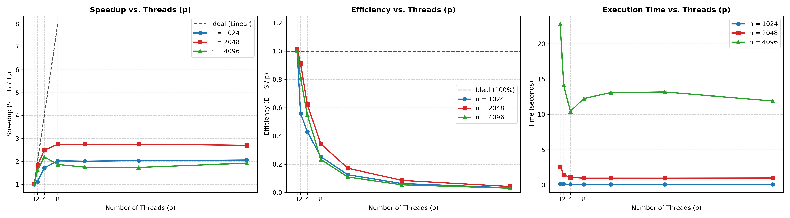

# Serial and Numba-parallel matrix multiplication

This folder compares a serial matrix multiplication with a row-parallel
implementation using Numba's `prange`. It benchmarks square `float64` matrices
of sizes `1024 × 1024`, `2048 × 2048`, and `4096 × 4096` on the reported
**10th-generation Intel Core i5 with 4 CPU cores**. The test sweeps Numba thread
counts `p = [1, 2, 4, 8, 16, 32, 64]`, including configurations that
oversubscribe the four-core CPU.

## Files in this folder

- [`local_v0_v1.py`](./local_v0_v1.py): serial and parallel kernels, warm-up,
  correctness checks, and benchmark runner.
- [`matmul_v0_v1_results.csv`](./matmul_v0_v1_results.csv): four timing samples
  and median, speedup, and efficiency for each configuration.
- [`logs.txt`](./logs.txt): run progress, repetition timings, and summary
  output. The final summary agrees with the CSV values documented here.
- [`plot_results.py`](./plot_results.py): reads the CSV and generates the
  figures.
- [`v0_v1_oversubscribed_plots.png`](./v0_v1_oversubscribed_plots.png):
  speedup, efficiency, and parallel execution-time plots.
- [`requirements.txt`](./requirements.txt): Python packages used by the
  project.

## Implementations and benchmark method

Both versions use explicit three-loop matrix multiplication. The serial
version (`v0_serial`) iterates over rows of `A`, then the shared dimension,
then columns of `B`. The parallel version (`v1_parallel`) uses Numba
`prange` over rows; each parallel iteration writes a different row of the
output matrix, avoiding write conflicts between workers.

Numba JIT compilation is warmed up before timing. For each matrix size, the
program creates `A` and `B`, computes a NumPy `A @ B` reference, and runs four
timed repetitions of the serial kernel and each parallel thread-count
configuration. The output matrix is reset before every repetition, and
`numpy.allclose` checks each result against the reference. The median of the
four repetitions is used in the CSV and plots.

The script sets the Numba thread pool maximum to 64 and uses Numba's
`workqueue` threading layer. `set_num_threads(p)` selects the active thread
count for each parallel measurement. This lets the benchmark test beyond the
four physical cores, but does not add compute resources: `p > 4` is
oversubscription on the reported CPU.

### Metrics

- **Median time** is the median of four kernel execution times, in seconds.
- **Speedup** is `S = T_serial / T_parallel`, using the median serial
  (`v0_serial`) time for the same matrix size as the reference.
- **Efficiency** is `E = S / p`, where `p` is the active Numba thread count.

The `v1_parallel, p = 1` row is still the parallel Numba kernel, not the
serial baseline. A small difference between its timing and `v0_serial` is
expected because they are separate compiled functions and may be affected by
measurement variation. Accordingly, speedup and efficiency can be slightly
above or below 1.0 at `p = 1`.

## Results

Times below are median seconds. The speedup and efficiency columns are the
values recorded in the CSV; the `v0_serial` row is the reference for each
matrix size.

### `n = 1024`

| Version | Threads (`p`) | Median time (s) | Speedup | Efficiency |
|---|---:|---:|---:|---:|
| Serial baseline | 1 | 0.1640 | 1.000× | 100.00% |
| Numba parallel | 1 | 0.1644 | 0.998× | 99.76% |
| Numba parallel | 2 | 0.1467 | 1.118× | 55.89% |
| Numba parallel | 4 | 0.0952 | 1.722× | 43.04% |
| Numba parallel | 8 | 0.0810 | 2.025× | 25.32% |
| Numba parallel | 16 | 0.0815 | 2.011× | 12.57% |
| Numba parallel | 32 | 0.0806 | 2.034× | 6.36% |
| Numba parallel | 64 | 0.0795 | 2.063× | 3.22% |

The serial baseline takes 0.1640 s. The fastest recorded parallel time is
0.0795 s at 64 threads, a 51.5% reduction and a 2.06× speedup relative to
serial. However, 8 threads already achieve 0.0810 s; using 64 rather than 8
threads saves only about 1.8% more time while reducing efficiency from 25.32%
to 3.22%. This is a clear case where the lowest measured time is not a
resource-efficient choice. Given the small workload and four-core processor,
8 threads are a more practical point in this sweep than 64, though the small
timing difference should be re-tested before treating it as meaningful.

### `n = 2048`

| Version | Threads (`p`) | Median time (s) | Speedup | Efficiency |
|---|---:|---:|---:|---:|
| Serial baseline | 1 | 2.6709 | 1.000× | 100.00% |
| Numba parallel | 1 | 2.6243 | 1.018× | 101.78% |
| Numba parallel | 2 | 1.4639 | 1.824× | 91.22% |
| Numba parallel | 4 | 1.0723 | 2.491× | 62.27% |
| Numba parallel | 8 | 0.9710 | 2.751× | 34.38% |
| Numba parallel | 16 | 0.9727 | 2.746× | 17.16% |
| Numba parallel | 32 | 0.9712 | 2.750× | 8.59% |
| Numba parallel | 64 | 0.9873 | 2.705× | 4.23% |

The best time is 0.9710 s at 8 threads, about 63.6% faster than serial.
Results at 8, 16, and 32 threads are nearly tied, within about 0.2% of one
another. The difference is smaller than should be considered decisive from
only four repetitions. At 64 threads performance slips slightly. Eight
threads are twice the number of physical cores, so the small extra gain over
four threads comes with lower efficiency and oversubscription.

### `n = 4096`

| Version | Threads (`p`) | Median time (s) | Speedup | Efficiency |
|---|---:|---:|---:|---:|
| Serial baseline | 1 | 22.9415 | 1.000× | 100.00% |
| Numba parallel | 1 | 22.8205 | 1.005× | 100.53% |
| Numba parallel | 2 | 14.1533 | 1.621× | 81.05% |
| Numba parallel | 4 | 10.4358 | 2.198× | 54.96% |
| Numba parallel | 8 | 12.2557 | 1.872× | 23.40% |
| Numba parallel | 16 | 13.0886 | 1.753× | 10.95% |
| Numba parallel | 32 | 13.1783 | 1.741× | 5.44% |
| Numba parallel | 64 | 11.8990 | 1.928× | 3.01% |

The largest matrix benefits from parallelism up to the four physical cores.
Four threads are the best measured configuration at 10.4358 s, a 54.5%
reduction from serial and a 2.20× speedup. Increasing to 8 threads raises
runtime to 12.2557 s, about 17.4% slower than four threads. The 16- and
32-thread cases are slower still. The 64-thread result improves on 8–32
threads, but remains about 14.0% slower than the four-thread result and has
only 3.01% efficiency. This non-monotonicity is consistent with oversubscription
and run-to-run variation; adding threads beyond the core count does not
produce a reliable improvement.

## Interpreting the plots

### Speedup

Speedup is calculated against the serial `v0_serial` baseline, not against
the `v1_parallel, p = 1` row. The dashed line is ideal linear speedup. The
measured speedup increases with useful parallelism but is far below the ideal
line once thread count grows. Best observed speedups are about 2.06× for
`n = 1024` at 64 threads, 2.75× for `n = 2048` at 8 threads, and 2.20× for
`n = 4096` at 4 threads.

### Efficiency

Efficiency is speedup divided by the number of threads. It falls as `p`
increases because speedup does not increase proportionally. For example,
`n = 4096` reaches its best time at four threads with 54.96% efficiency;
at 64 threads, its speedup is lower and efficiency is just 3.01%. Efficiency
slightly above 100% at `p = 1` for two sizes is a small timing difference
between the serial and parallel kernels, not parallel scaling.

### Execution time

The time plot shows the parallel kernel only; serial baselines are provided
in the tables. For 1024 and 2048, many-thread configurations approach a
performance plateau, so large increases in thread count yield little
additional speed. For 4096, the minimum is at four threads and runtime
increases when more threads compete for the four-core CPU.

The plot-generation script currently sets explicit x-axis ticks only for
`[1, 2, 4, 8]`, although the plotted data extends through 64 threads. Values
at 16, 32, and 64 are present, but their tick labels may be absent from the
figure. Read those points together with the CSV tables.

## Conclusion

The Numba-parallel kernel is faster than the serial baseline for all three
matrix sizes when using multiple threads, but it does not scale linearly.
The best measured settings in this run are:

| Matrix size | Best measured threads | Median time | Speedup vs. serial |
|---:|---:|---:|---:|
| 1024 | 64 | 0.0795 s | 2.06× |
| 2048 | 8 | 0.9710 s | 2.75× |
| 4096 | 4 | 10.4358 s | 2.20× |

The 1024 result at 64 threads is only marginally faster than at 8 threads,
and the 2048 results from 8 through 32 threads are effectively tied. For the
largest input, using the four available cores gives the best measured
runtime; oversubscribing them makes performance worse. These are the fastest
individual medians among four repetitions, not proof that each optimum is
statistically significant. More repetitions under controlled system load
would make small differences and the non-monotonic high-thread results more
reliable.
